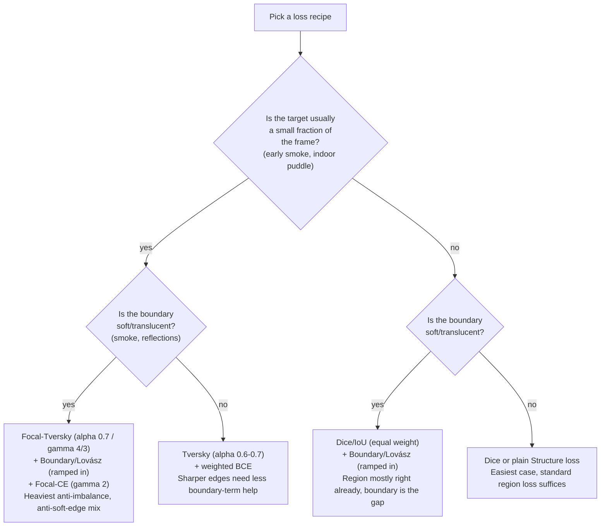
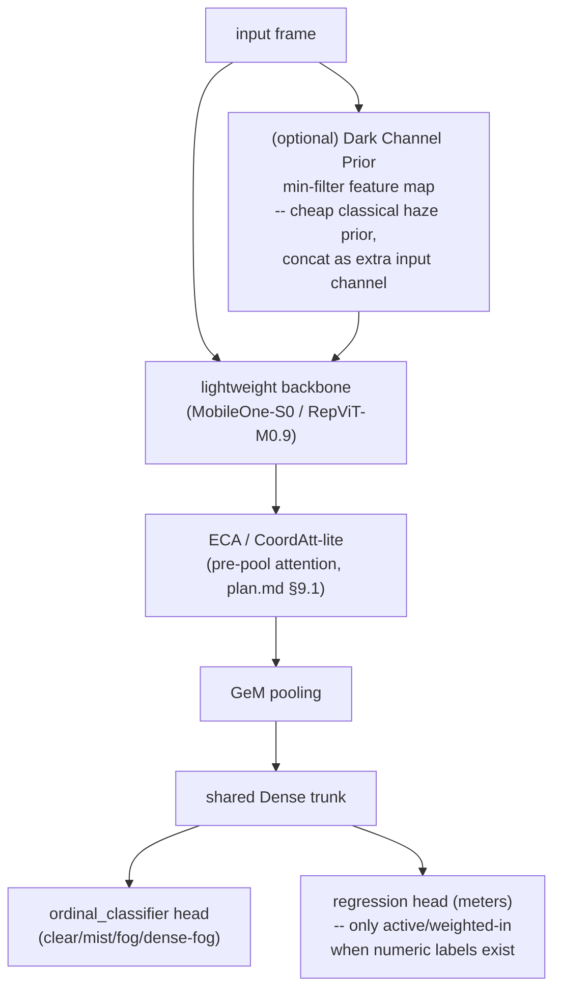
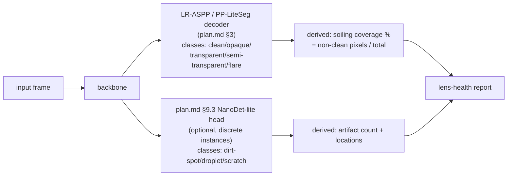

# Use-case recipes: applying the SAK plan to specific tasks

Companion to [plan.md](plan.md) — that file tracks *what infrastructure* to
build (backbones, decoders, losses, optimizers, classification/detection
heads). This file tracks *how to apply that infrastructure* to specific
tasks: recommended loss/hyperparameter combinations and training knobs for
water/smoke segmentation, visibility estimation, and lens-health detection.
Every reference to one of `plan.md`'s own sections is written as `plan.md
§X`; a plain `§X` refers to a section within this file.

> **Implementation status of what these recipes mention** (checked against
> the code on 2026-11-05). Available: every loss named below, the `SAM`
> optimizer wrapper, `tta_predict`, `ordinal_classifier`, the attention
> pooling layers, the DDRNet auxiliary head and `deep_supervision_loss`,
> the freeze/unfreeze phases of `TrainingDriver`. **Not implemented yet**,
> although the text recommends them: EMA and SWA weight averaging,
> rare-class-aware and domain-balanced batch sampling in `dataset_utils.py`,
> loss-weight ramping (it has to be done with a custom callback), a
> differential learning rate for backbone and head, and the dark-channel
> input feature. They are tracked in [ROADMAP.md](ROADMAP.md). None of the
> recipes has been validated on a real dataset yet.

## 1. Water & smoke segmentation: combining losses & hyperparameters (indoor + outdoor)

There isn't one universal recipe — the four target scenarios differ enough in
class imbalance, boundary character, and domain variability that they need
different loss weightings and training knobs. The underlying principle,
though, is the same in all four cases: **no single loss family covers both
"get the region right" and "get the soft boundary right"**, so combine a
region loss + a boundary/rank loss + a pixel-wise loss, and tune the mix (not
just the individual loss hyperparameters) to the scenario.

### 1.1 Per-scenario recipes

| Scenario | Dominant failure mode | Loss mix (starting point) | Notes |
|---|---|---|---|
| **Outdoor flooding / water** (rivers, floodwater, coastal) | Specular reflections & sky/water confusion; region can be *large* (flood covers half the frame) or a thin river strip — imbalance varies by shot | `0.5*Tversky(alpha=0.6) + 0.3*Lovász-Softmax + 0.2*weighted-BCE` | Lovász over Boundary-loss here: reflections/wave texture make a clean distance-transform boundary noisy, while Lovász optimizes IoU directly and tolerates ragged edges better. |
| **Indoor flooding / water** (leaks, puddles, wet floors) | Small, thin regions; low class fraction; sharp-but-low-contrast edges; reflective flooring produces false positives | `0.6*Focal-Tversky(alpha=0.7, gamma=4/3) + 0.25*Boundary-loss (ramped 0→1 over first ~20% of training) + 0.15*OHEM-CE` | High alpha to penalize missed leaks (false negatives costlier than false alarms); OHEM specifically targets the reflective-floor false-positive failure mode; boundary loss works well here because puddle edges, unlike smoke, are usually geometrically sharp. |
| **Outdoor smoke** (wildfire, industrial stack) | Highly translucent, blends into sky/haze; large scale variance (near dense plume vs. far thin wisp); heavy motion blur on video | `0.4*Dice + 0.35*Boundary-loss (ramped) + 0.25*Focal-CE(gamma=2, alpha tuned to class freq)` | Favor Dice/Boundary over Tversky-with-high-alpha here — outdoor smoke plumes are often *not* small-object-imbalanced (a wildfire plume can dominate the frame), so aggressive FN-weighting isn't automatically right; tune alpha from actual class-frequency stats instead of assuming. |
| **Indoor smoke** (fire ignition, steam/vapor leaks) | Usually small/early (this is the "detect it before it's obvious" use case); easily confused with steam/dust/fog; extreme imbalance | `0.55*Focal-Tversky(alpha=0.75, gamma=4/3) + 0.25*Boundary-loss (ramped) + 0.20*class-balanced Focal-CE` | Highest FN-penalty of all four (alpha 0.75) — missing early indoor smoke is the costliest failure in this whole set; pair with the DDRNet auxiliary head (plan.md §3.3) since deep supervision measurably helps small/early-stage targets. |

Weights above are starting points to tune per-dataset, not fixed constants —
but the *shape* of the recipe (which families to combine, and which one gets
majority weight) should transfer.

### 1.2 Training knobs that matter as much as the loss mix

- **Ramp the boundary/rank term in, don't fix it from step 0.** Boundary loss
  and Lovász-Softmax both produce noisy/unhelpful gradients before the model
  has learned coarse regions — start their weight at 0 and linearly increase
  to the target value over the first ~10-20% of training (standard practice
  from the boundary-loss paper, applies equally to Lovász here).
- **Guarantee positive examples per batch, don't rely on loss weighting alone.**
  For the small-object cases (indoor smoke, indoor puddles) an all-negative
  batch produces a degenerate gradient regardless of how the loss is
  weighted — use rare-class-aware batch sampling in `dataset_utils.py`
  alongside, not instead of, Focal-Tversky/OHEM.
- **Differential learning rate.** Lower LR (or `freeze_backbone=True` then a
  short unfreeze phase) on the pretrained encoder, higher LR on the new
  decoder head — the freeze/unfreeze knobs already exist in
  `training_utils.py`, this is a usage recommendation, not new code.
- **Cross-domain (indoor+outdoor) generalization.** If a single model must
  cover both indoor and outdoor variants of the same class (e.g. one "water"
  model for both), prefer: (a) domain-balanced sampling so one domain doesn't
  dominate gradient steps, and (b) the SAM optimizer wrapper (plan.md §4.2) —
  SAM's flatter minima specifically help when train/test distributions shift,
  which indoor↔outdoor lighting/texture is a textbook case of. A FiLM-style
  domain-conditioning input is worth trying only if domain-balanced sampling +
  SAM isn't enough, since it adds complexity/inference-time coupling.
- **EMA + SWA for eval stability.** Small/rare-object gradients are noisy
  batch-to-batch; EMA weights (plan.md §4.2) or SWA give a meaningfully more
  stable final checkpoint than picking the best raw-validation-step
  checkpoint, especially for the indoor small-object cases.
- **Deep supervision weight.** For DDRNet's auxiliary head (plan.md §3.3),
  the original paper's constant ~0.4 weight on the aux loss is a reasonable
  default for all four scenarios; it's most valuable for indoor smoke and
  indoor water (small/early targets) and closer to optional for large-region
  outdoor flooding.
- **TTA at eval time.** Multi-scale + flip test-time augmentation (plan.md
  §4.3) is disproportionately useful for outdoor smoke specifically, since
  plume scale varies more with camera distance than any other target here.

## 2. Visibility distance estimation (clear air vs. mist vs. fog)

Frame this as a **shared-trunk, two-head** classifier, not a single regression
or single classification model — clean numeric ground truth (meters of
visibility) is rarely available at scale, but coarse ordinal labels
(clear/mist/fog/dense-fog) usually are, and the two are complementary. This
task consumes the classifier/attention building blocks from `plan.md` §9
(`ordinal_classifier`, GeM/ECA/CoordAtt-lite) rather than needing anything new:

- **Why `ordinal_classifier` (plan.md §9.2) and not plain softmax**: visibility
  is an ordinally ranked label set (clear < mist < fog < dense-fog) — plain
  categorical cross-entropy treats "predicted clear, true dense-fog" (a
  dangerous miss) and "predicted mist, true fog" (a minor miss) as equally
  wrong, which throws away exactly the ordering information that matters for
  this task.

- **Why concatenate a Dark-Channel-Prior feature**: fog/haze density
  estimation has a strong, nearly-free classical prior (the dark channel of a
  haze-free patch tends to be low; haze raises it) — giving the lightweight
  backbone this as an extra input channel means it doesn't have to rediscover
  haze statistics from scratch on a small labeled set, which matters more for
  the tiny edge backbones in this plan than for a large model.
- **Loss**: ordinal cross-entropy (or CORAL's binary-threshold loss) as the
  primary term; add the regression term (Huber/Smooth-L1) only weighted-in
  (else 0) for samples that actually carry a numeric visibility label — a
  masked multi-task loss, not two always-on terms.
- **Metrics**: ordinal accuracy / Cohen's kappa (respects the class ordering)
  instead of plain top-1 accuracy, plus MAE-in-meters wherever numeric labels
  exist — plain accuracy on an ordinal 4-class problem hides "predicted clear,
  true dense-fog" (a dangerous miss) vs. "predicted mist, true fog" (a minor
  miss) as equally wrong.
- **Domain note**: reuse the SAM-optimizer + domain-balanced-sampling
  recommendation from §1.2 if the same model must cover multiple camera/lens
  types or day/night conditions — visibility estimation is exactly as
  domain-shift-sensitive as the water/smoke tasks.

## 3. Lens dirt / flare / artifact detection ("lens health")

Recommend **segmentation-first**, matching the convention used by the
WoodScape "soiling" benchmark, with a class set: `clean`, `opaque` (mud/dirt),
`transparent` (water droplets), `semi-transparent` (smudge/condensation),
`flare/glare`. Reuse the decoders in `plan.md` §3 directly — no new
architecture needed for this framing, just a class set + loss recipe:

- **Why `CoordAtt-lite` (plan.md §9.1) over plain GAP/ECA if this task also
  gets a classification pre-check/severity head**: dirt tends to cluster at
  frame edges/corners, and flare direction correlates with where the light
  source enters the frame — position-blind pooling discards exactly that
  signal, whereas CoordAtt-lite's split H/W pooling keeps it.
- **Why `multilabel_classifier` (plan.md §9.2) if framed as classification
  rather than segmentation**: these artifacts **co-occur** — dirt *and* flare
  *and* condensation can all be true at once for one frame — so single-label
  multi-class is a structural mismatch here, not a tuning problem.

- Loss recipe follows the §1.1 "indoor smoke" row (same profile: small,
  soft-edged, heavily-imbalanced regions) — `Focal-Tversky(alpha≈0.7-0.8,
  gamma=4/3)` + ramped-in boundary loss + class-balanced focal-CE.
- **Flare/glare is a segmentation target even in an otherwise
  detection-based pipeline** — it's a soft, blooming, saturation-correlated
  region, not a tight countable box; forcing it into a bounding box discards
  the information that actually matters (how much of the frame is
  glare-corrupted).
- A **hybrid pipeline** is worth it only when discrete, countable artifacts
  (dust specks, scratches, individual droplets) need per-instance
  identification — then add the detector from `plan.md` §9.3 for those
  classes (`dirt-spot`, `water-droplet`, `scratch`) alongside the
  segmentation head, rather than replacing it:

- **Derived health signal, not a new head**: "soiling coverage %" is just a
  post-hoc reduction over the segmentation mask (non-clean pixels / total) —
  cheap, and immediately useful as a gating signal ("suppress/flag downstream
  perception outputs when soiling coverage exceeds threshold X"). Worth a
  small utility function (e.g. in `quantization_utils.py`, or a new
  `perception_health_utils.py` if it grows beyond one function) rather than a
  new model output.
- **Metric gap**: object-detection mAP has no existing home in `metrics.py`
  (only `MeanIOU` today) — if the hybrid/detection path is built, a
  COCO-style mAP metric utility is needed alongside it (ties into the
  `plan.md` §8 "boundary-sensitive metrics" gap — `metrics.py` needs both a
  boundary metric for segmentation and a mAP metric for detection).
